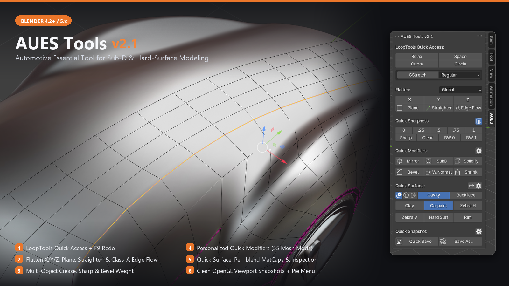
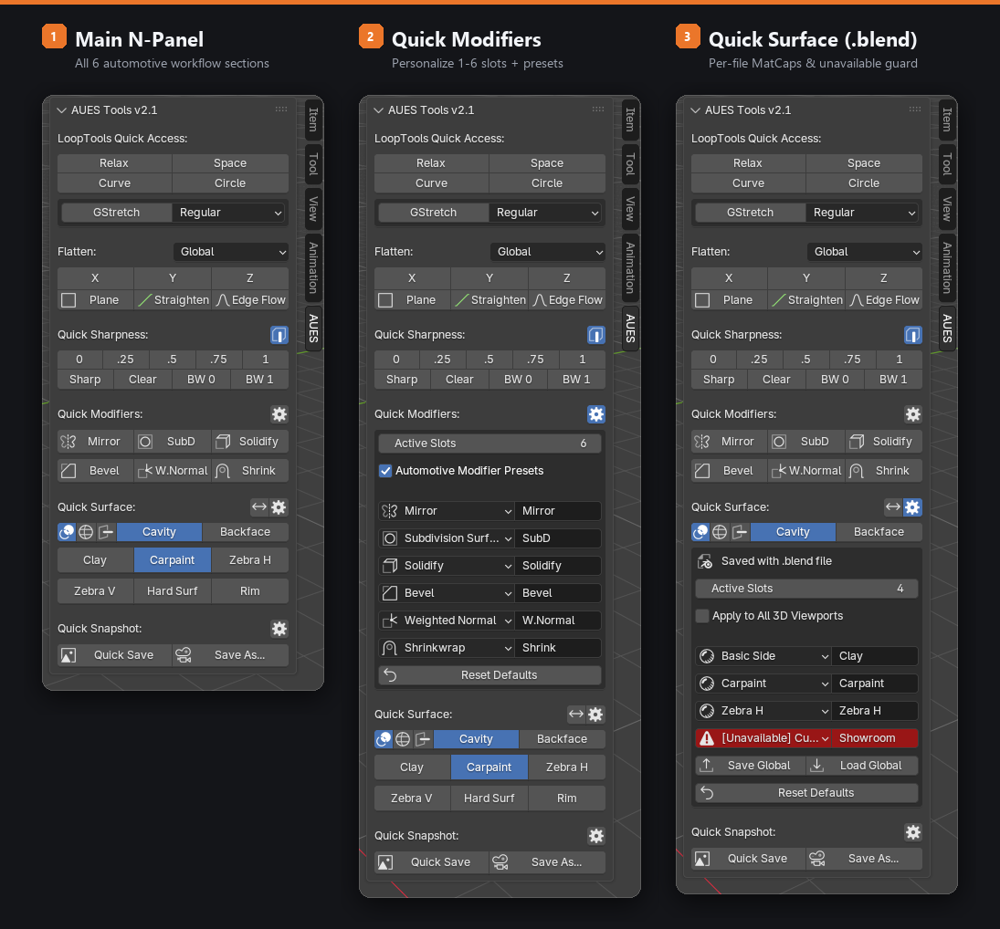
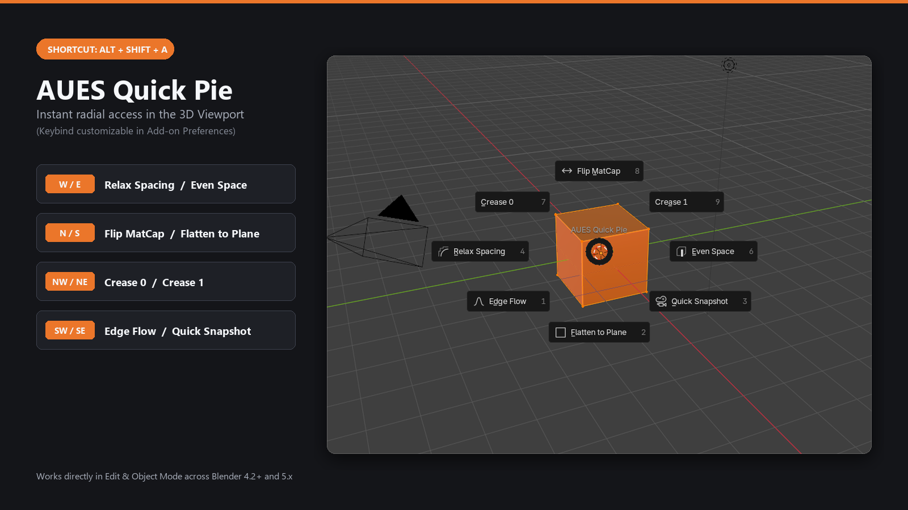

# Automotive Essential Tool (AUES) v2.1



A streamlined **Blender 4.2+ / 5.x Extension** built for automotive Sub-D & hard-surface modeling workflows. Consolidates the high-frequency modeling, fairing, modifier, surface-inspection, and viewport-capture actions you reach for constantly into a single N-Panel (`View 3D > N > AUES`) and quick Pie Menu (`Alt + Shift + A`).

> [!NOTE]
> AUES Tools is a lightweight workflow shortcut add-on that brings Blender's existing built-in modeling, modifier, shading, and viewport tools into one convenient N-Panel and Pie Menu for faster access. It is designed to streamline everyday clicks and menu navigation rather than introduce new standalone modeling systems.

- **Author:** `wbwbwb`
- **Compatibility:** Blender **4.2+** (tested on **Blender 4.5.15 LTS** & **Blender 5.2.3 LTS**)
- **License:** GPL-3.0-or-later

---

## UI Overview



---

## Features

### 1. LoopTools Quick Access
- 1-click access to **Relax**, **Space**, **Curve**, **Circle**, and **GStretch** (`Project` / `Irregular` / `Regular`) with native **F9 Redo Panel** controls restored.
- Automatic detection and 1-click enable helper supporting both **Blender 4.2+ Extensions (`bl_ext.*.looptools`)** and legacy `mesh_looptools`.

### 2. Flatten, Straighten & Edge Flow
- **Flatten `X` / `Y` / `Z`** with inline Transform Orientation selector (`Active`, `Global`, `Local`, `Normal`, `View`).
- **Plane**: Self-contained best-fit average-normal plane flattening (with F9 `Influence`).
- **Straighten (Snap to Line)**: Aligns selected vertices onto a straight line between their endpoints — supports multiple disconnected edge chains at once as well as loose vertex selections, with F9 `Spacing` (`Preserve Position`, `Arc Length`, `Even Spacing`) and `Influence`.
- **Edge Flow**: Repositions selected interior edge loops along a 4-point chord-length cubic spline derived from surrounding quad rings for Class-A surface curvature fairing, with F9 `Tension`, `Influence`, `Iterations`, and `Preserve Spacing`.

### 3. Quick Sharpness
- Multi-object Edit Mode **Edge Crease** presets (`0 | .25 | .5 | .75 | 1`) + viewport Crease Overlay toggle.
- 1-click **Sharp / Clear** edge shading flags and **BW 0 / BW 1** Bevel Weight controls.

### 4. Quick Modifiers (Personalizable)
- 1–6 customizable quick-add modifier buttons supporting all **55 mesh-compatible Blender modifiers** with official icons and optional custom short labels.
- Ships with 6 automotive defaults: **Mirror**, **SubD**, **Solidify**, **Bevel**, **W.Normal**, and **Shrinkwrap**.
- Optional **Automotive Modifier Presets** toggle applies practical initial settings automatically (Mirror Clipping, SubD Level 2 + Optimal Display, Bevel Weight limit, Weighted Normal Keep Sharp, Solidify inward panel thickness).

### 5. Quick Surface (Per-`.blend` MatCaps & Inspection)
- **Surface Inspection Strip** right above the MatCap selector: quick toggles for **Overlays**, **Wireframe**, **Face Orientation**, **Cavity**, and **Backface Culling**.
- **1–6 Customizable MatCap Slots** saved directly inside each **`.blend` file** (with one-click **Save Global** / **Load Global** sync to Add-on Preferences for new files).
- **Unavailable MatCap Detection**: If a `.blend` file references a custom MatCap not installed on the current machine, the slot is clearly marked `(Unavailable)` without silently overwriting your saved reference.
- **Flip MatCap** button (`Shift+Click` swaps Horizontal / Vertical Zebra reflection checks).
- **Split-View Safe**: Updates only the active 3D Viewport by default (`Shift+Click` or toggle applies to all viewports).

### 6. Quick Snapshot
- **Viewport Render (Clean OpenGL)** mode (anti-aliased at scene resolution, zero UI chrome, optional transparent PNG) alongside fast **Area Capture** mode.
- **1-Click Quick Save** with auto-numbered PNGs to a configurable folder, plus timestamped `Save As...`.

### 7. Quick Pie Menu (`Alt + Shift + A`)
Instant radial access in the 3D Viewport (shortcut customizable in Add-on Preferences):
- **West / East:** Relax Spacing / Even Space
- **North / South:** Flip MatCap / Flatten to Plane
- **NW / NE:** Crease 0 / Crease 1
- **SW / SE:** Edge Flow / Quick Snapshot



---

## Installation (Blender 4.2+)

1. Download **`Automotive_Essential_Tool_v2.1.zip`** from the [Latest Release](https://github.com/Gregrioum/AUES-Tools/releases/latest) page.
2. In Blender, either:
   - **Drag and drop** the `.zip` file directly into the Blender window, **or**
   - Go to **`Edit > Preferences > Get Extensions`**, click the top-right dropdown (`v`), and choose **`Install from Disk...`**.
3. Open the 3D Viewport sidebar (**`N`**) and select the **`AUES`** tab.
4. *(Optional)* If **LoopTools** is not yet enabled, click the built-in **Enable LoopTools** button at the top of the AUES panel (or install `LoopTools` from `Edit > Preferences > Get Extensions`).

---

## Building from Source

Using Blender's official Extension CLI (Blender 4.2+):

```bash
blender --command extension build --source-dir ./automotive_essential_tool --output-filepath ./Automotive_Essential_Tool_v2.1.zip
```

Validate the built package:

```bash
blender --factory-startup --command extension validate ./Automotive_Essential_Tool_v2.1.zip
```

---

## Changelog

See [CHANGELOG.md](CHANGELOG.md) for the full version history.

## License

Licensed under the **GNU General Public License v3.0 or later** — see [LICENSE](LICENSE) for details.
